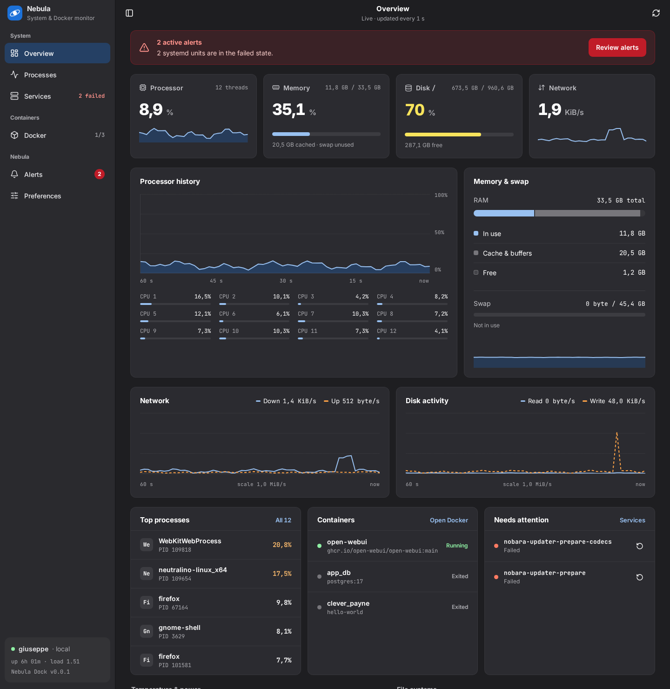
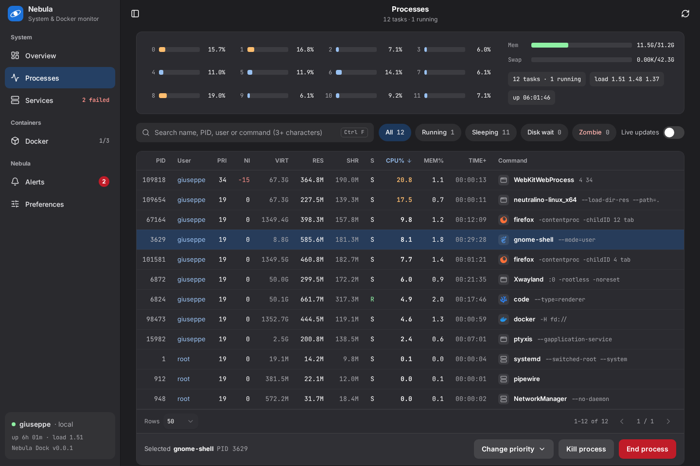
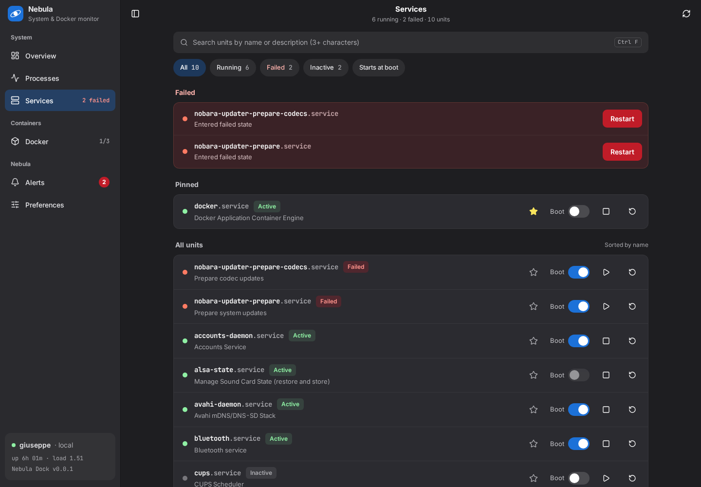
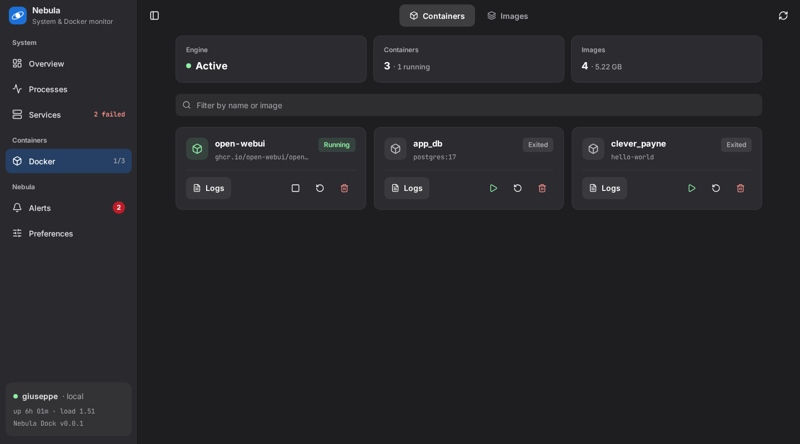
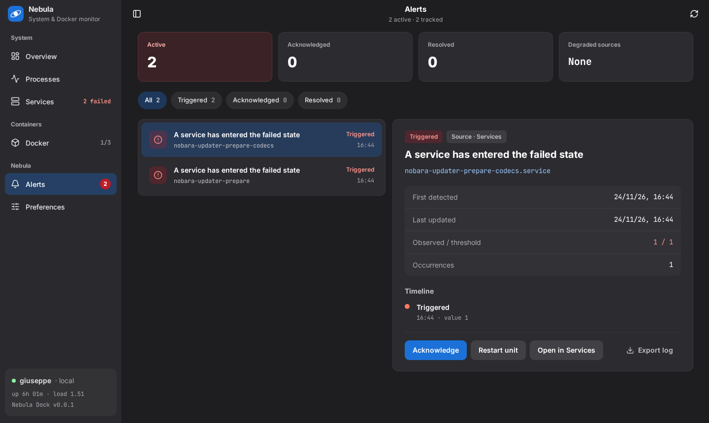
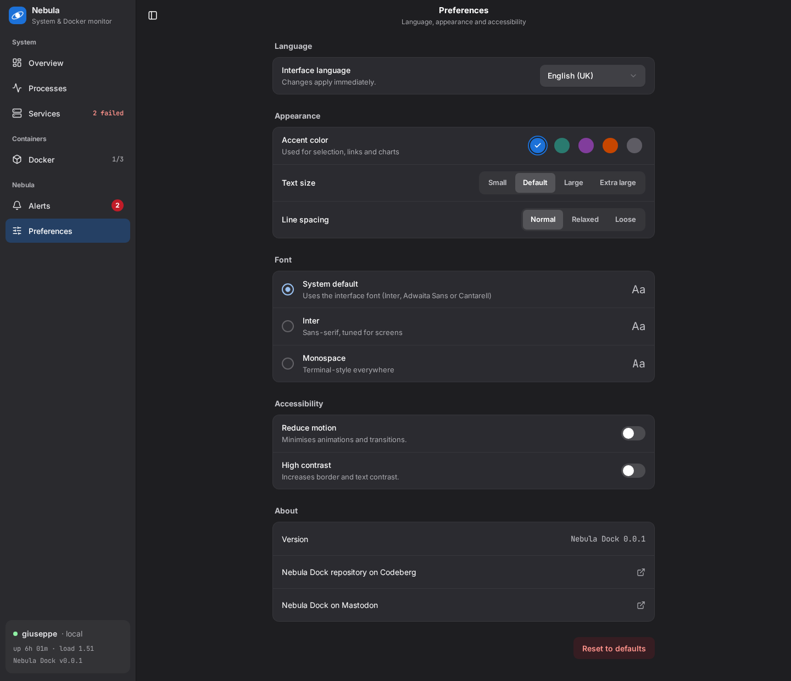

# Nebula Dock

Nebula Dock is a desktop system monitor for Linux. It shows live resource
usage, running processes and systemd services, and manages Docker containers
and images. An alert center watches the system in the background and reports
problems such as failed services or resource pressure.

The interface follows GNOME and libadwaita conventions ("Graphite Adwaita"
design), so it feels at home on Fedora, Nobara and other GNOME desktops. The
app is built with Vue 3 and runs as a native window through Neutralinojs.



## Features

- **Overview**: CPU, memory, disk and network at a glance, a 60 second history
  per core, memory and swap breakdown, network and disk activity, top
  processes, containers, temperatures, power draw and file systems. A health
  banner appears when alerts are active.
- **Processes**: an htop-style table with per-core load, sorting, search,
  status filters, priority changes, and end or kill actions. Destructive
  actions ask for confirmation.
- **Services**: every systemd unit with its state, boot setting and
  start, stop and restart actions. Failed units are listed first, and units
  can be pinned.
- **Docker**: container cards with start, stop, restart, logs and remove,
  and an image list with pull and delete. Images used by a container cannot
  be deleted.
- **Alerts**: alerts for CPU, memory, swap, disk space, process load, failed
  services and temperatures, with a timeline, acknowledge, export and
  desktop notifications. The sidebar badge, the Overview banner and the
  Alerts page always show the same count.
- **Preferences**: English and Italian, five accent colors, text size, line
  spacing, interface font, reduced motion and high contrast.
- **Works offline**: fonts and assets ship with the app.

## Screenshots

| Processes | Services |
| --- | --- |
|  |  |

| Docker | Alerts |
| --- | --- |
|  |  |



The screenshots were taken with sample data.

## Tech stack

| Area | Tools |
| --- | --- |
| Frontend | Vue 3 (Composition API, `<script setup>`, Pug templates), TypeScript |
| UI | Tailwind CSS v4, shadcn-vue, Reka UI, Lucide icons |
| State and data | Pinia, Pinia Colada, vue-i18n |
| Desktop runtime | Neutralinojs |
| Tooling | Bun workspaces, Vite, Vitest, Playwright, oxlint, ESLint |

## Repository layout

| Path | Purpose |
| --- | --- |
| `client/` | Vue 3 and Vite frontend (see [client/README.md](client/README.md)) |
| `bin/` | Neutralino runtime binaries for each platform |
| `design/nebula-handoff/` | Design specification, theme tokens and static previews |
| `docs/screenshots/` | Screenshots used in this README |
| `neutralino.config.json` | Neutralino desktop runtime configuration |
| `CONTRIBUTING.md` | Contributor workflow and development standards |

## Requirements

- WebKitGTK 4.1 (`webkit2gtk4.1` on Fedora, `libwebkit2gtk-4.1-0` on Debian
  and Ubuntu), used by Neutralino to draw the window.
- Linux with systemd. Docker is optional: the Docker page shows a notice
  when the engine is not reachable.
- Optional: `lm-sensors` for temperatures, and RAPL (Intel) or `nvidia-smi`
  for power readings.
- Actions that need root privileges, such as stopping a service or ending
  another user's process, ask for authentication through polkit (`pkexec`).

To build from source you also need:

- Git
- Bun 1.4.0 or a compatible release
- Node.js `^22.18.0 || >=24.12.0` for the client toolchain
- The Neutralino CLI (`neu`)
- [git-flow-next](https://github.com/gittower/git-flow-next), installed as
  the external `git flow` command, if you plan to contribute

## Getting started

Install the dependencies from the repository root:

```bash
bun install
```

Run the desktop app with Neutralino:

```bash
neu run
```

Or run only the frontend in a browser:

```bash
bun --cwd=client run dev
```

In a browser the native calls are mocked, so the pages load but show no
system data. Use `neu run` for anything that depends on Neutralino APIs.

## Production build

The production build type-checks and bundles the client, then packages it
with Neutralino. The client files are embedded in each binary, so the app is a
single executable with no separate `resources.neu` file.

From the repository root:

```bash
bun install
bun run build:prod
```

`build:prod` runs these two steps, which you can also run by hand:

```bash
bun --cwd=client run build                  # type-check and Vite build into client/dist/
neu build --release --embed-resources       # package the binaries into dist/
```

The output goes to `dist/`:

| Path | Content |
| --- | --- |
| `dist/nebula-dock/nebula-dock-linux_x64` | Linux x86_64 |
| `dist/nebula-dock/nebula-dock-linux_arm64` | Linux ARM64 |
| `dist/nebula-dock/nebula-dock-linux_armhf` | Linux ARMv7 |
| `dist/nebula-dock/nebula-dock-mac_x64`, `-mac_arm64`, `-mac_universal` | macOS |
| `dist/nebula-dock/nebula-dock-win_x64.exe` | Windows x86_64 |
| `dist/nebula-dock-release.zip` | All the binaries above in one archive |

Run the Linux build:

```bash
./dist/nebula-dock/nebula-dock-linux_x64
```

### AppImage

To build an AppImage that you can open with Gear Lever or any AppImage
launcher:

```bash
bun run build:appimage
```

This runs `build:prod` and then `scripts/build-appimage.sh`, which writes
`dist/Nebula_Dock-<version>-<arch>.AppImage` (x86_64 or aarch64, matching the
build machine). The script uses `appimagetool` from your `PATH`. If it is not
installed, the script downloads it once into `~/.cache/nebula-dock/`.

The AppImage does not bundle WebKitGTK: the target system needs
`webkit2gtk4.1` (Fedora) or `libwebkit2gtk-4.1-0` (Debian, Ubuntu). Settings,
logs and pinned items are stored in `~/.local/share/nebula-dock/`, because the
AppImage itself is read-only.

Nebula Dock reads system data through `systemctl`, `/proc` and the Docker
CLI, so only the Linux builds are fully functional today.

## Commands

| Command | Purpose |
| --- | --- |
| `bun run build:prod` | Build the client and package the release binaries into `dist/` |
| `bun run build:appimage` | Build the release binaries, then the Linux AppImage |
| `bun run release` | Start the Release-it release workflow |
| `bun --cwd=client run build` | Type-check and build the client |
| `bun --cwd=client run type-check` | Run Vue and TypeScript type checking |
| `bun --cwd=client run lint` | Run oxlint and ESLint |
| `bun --cwd=client run test:unit` | Run the Vitest unit tests |
| `bun --cwd=client run test:e2e` | Run the Playwright end-to-end tests |

## Contributing

Use `develop` as the integration branch and `main` as the production branch.
After installing git-flow-next, activate the shared branch configuration:

```bash
git flow config sync
```

Create `feature/*`, `release/*` and `hotfix/*` branches with git-flow-next and
open a pull request for every change. Commits follow Conventional Commits and
are checked by commitlint.

See [CONTRIBUTING.md](CONTRIBUTING.md) for the full workflow and
[client/README.md](client/README.md) for frontend conventions.

## License

Nebula Dock is released under the [MIT License](LICENSE).
